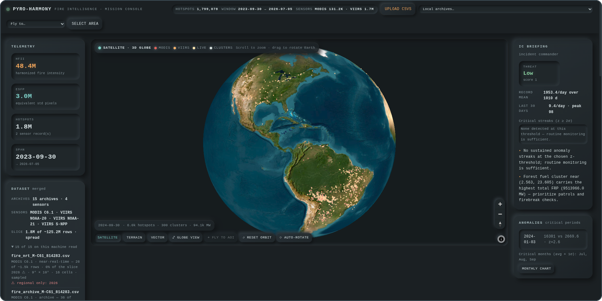
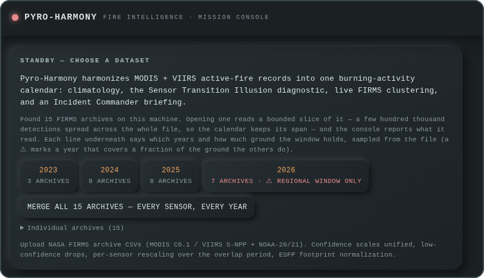
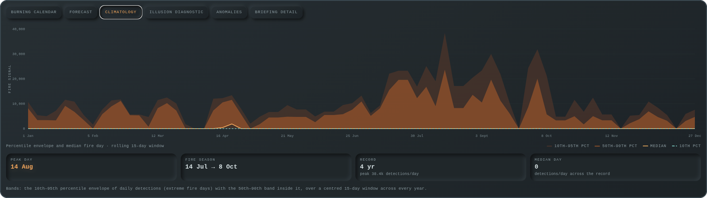
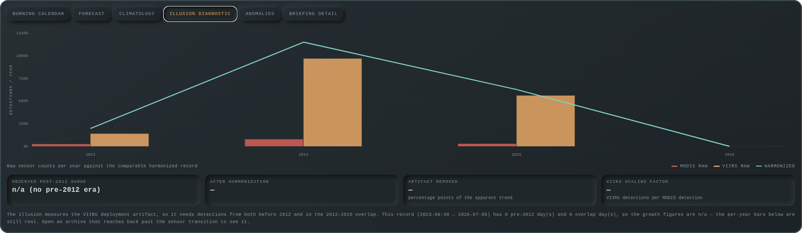

<div align="center">

# 🔥 Pyro-Harmony

### One fire record. Two satellites. No illusions.

**A burning-activity calendar that harmonizes NASA MODIS and VIIRS active-fire detections into a single comparable timeline, with the climatology, anomaly detection, hotspot clustering and incident briefing to make it useful.**

[](LICENSE)




*The mission console on the merged real archive: 1.8 M harmonized detections from MODIS C6.1 and VIIRS (S-NPP, NOAA-20, NOAA-21), 2023-09-30 → 2026-07-05.*

[**Quick start**](#quick-start) · [**Console tour**](#console-tour) · [**The illusion**](#the-sensor-transition-illusion) · [**API**](#api-reference) · [**Honest limitations**](#honest-limitations)

</div>

---

## The 30-second pitch

Satellites have watched Earth burn for more than twenty years, but the record is **split across two instruments that cannot be compared directly**. MODIS sees the world at 1 km and has flown since 2000. VIIRS sees it at 375 m and arrived in 2012. A VIIRS pixel resolves several times as many fires over the same ground, so a naive daily count **jumps the day VIIRS arrives**. It looks like fire exploded in 2012. Most of that is the satellite changing, not the planet.

Pyro-Harmony puts both sensors on one scale, then shows the record the way a fire manager actually needs it: *what is normal here, what is not, where is it burning right now, and what should we do first.*

| | MODIS C6.1 | VIIRS (S-NPP · NOAA-20 · NOAA-21) |
|---|---|---|
| Nadir resolution | 1 km | 375 m |
| Era | 2000 → present | 2012 → present |
| Confidence scale | 0–100 | categorical `l` / `n` / `h` |
| Raw counts comparable? | | **No.** That is the problem this solves. |

### At a glance

| | |
|---|---|
| **Real NASA data** | 15 FIRMS exports, **10.3 GB, 126.2 M rows**, merged into a 1.8 M-detection record in ~37 s |
| **Four pillars** | Calendar & climatology · Sensor Transition Illusion · Live ingestion & DBSCAN clustering · Incident Commander briefing |
| **Light by design** | ≈55 KB gzipped first paint, hand-rolled SVG charts, no charting library |
| **Verified** | 149 backend tests, four zero-dependency frontend guards, doc-figure and doc-link guards in CI |
| **Honest** | Samples are labelled as samples; unmeasurable results say so instead of showing zeros |

---

## Contents

- [What you get](#what-you-get)
- [Console tour](#console-tour)
- [The Sensor Transition Illusion](#the-sensor-transition-illusion)
- [Real data, honest numbers](#real-data-honest-numbers)
- [Quick start](#quick-start)
- [Getting FIRMS data](#getting-firms-data)
- [How it works](#how-it-works)
- [Built to run anywhere](#built-to-run-anywhere)
- [API reference](#api-reference)
- [Project structure](#project-structure)
- [Testing & CI](#testing--ci)
- [Security notes](#security-notes)
- [Honest limitations](#honest-limitations)
- [Troubleshooting](#troubleshooting)
- [License](#license)
- [Data, references and acknowledgements](#data-references-and-acknowledgements)
- [Contributing](#contributing)

---

## What you get

Four pillars, one console, every number computed from real NASA records.

| Pillar | What it answers | How |
|---|---|---|
| **1. Burning-activity calendar & climatology** | *Is this season normal?* | A GitHub-style day-by-day heatmap per year, plus a day-of-year percentile envelope (10th / 50th / 90th / 95th) that exposes onset, peak and cessation of the fire season. |
| **2. Sensor Transition Illusion diagnostic** | *How much of the trend is the satellite?* | Measures the VIIRS deployment artifact from days both sensors flew, removes it, and shows raw and harmonized series side by side with calibration stats. |
| **3. Live ingestion & hotspot clustering** | *Where is it burning right now?* | Pulls the 24 h NASA feeds (MODIS + three VIIRS platforms), harmonizes on the fly and DBSCAN-clusters detections into fire events with convex-hull extents. |
| **4. Incident Commander briefing** | *What do we do first?* | A threat level, critical streaks (z ≥ 2σ), K-means fuel-biome strata and ranked recommendations, exportable as Markdown. |

Around them: anomaly detection with a per-year view against a leave-one-year-out normal band, a 30-day forecast that only serves days it has earned, five curated fire regions (California, Amazon & Pantanal, Southeastern Australia, Punjab & Haryana, Mediterranean), and a 3D globe that morphs into a flat map as you zoom.

Headline metrics on every screen: **HFII** (harmonized fire intensity, Σ FRP·ESFP), **ESFP** (equivalent standard pixels, footprints normalized to each sensor's nadir cell), hotspot count and record span.

---

## Console tour

### Choose a dataset, knowing what you are choosing

A fresh console opens on a standby card listing the real FIRMS archives it finds. Each year is a button, and a year that is only a *regional* window (here, 2026) is flagged before you merge it into a global record.

<div align="center">



</div>

### Is this season normal?

The seasonal climatology on the merged real archive: the 10th–95th percentile envelope with the 50th–90th band inside it, the median fire day, and the peak day, season onset and cessation as cards beneath.

<div align="center">



</div>

### How much of the trend is the satellite?

The Sensor Transition Illusion diagnostic compares raw per-sensor counts with the harmonized record. On a modern archive (2023 onward) it does **not** invent a growth figure; it says plainly that the 2011 → 2012 transition is outside the record. See [the next section](#the-sensor-transition-illusion).

<div align="center">



</div>

---

## The Sensor Transition Illusion

This is the differentiator. The correction is **measured, not assumed**: the ratio of VIIRS to MODIS detections is taken from the days both instruments flew (2012–2015), and the comparable record keeps the larger of the two counts in a common unit per day, so a fire both sensors saw is counted once.

On the reference 2002–2024 record (the synthetic fixture the test suite pins, because the real archive on this project starts in 2023):

| | Post-2012 growth |
|---|---|
| Raw record | **+304.0 %** |
| After harmonization | **+11.7 %** |
| Artifact removed | **292.3 percentage points** |

Cross-sensor calibration over 9,767 matchups: daily-count R² 0.867, RMSE 2.91 MW, FRP ratio 0.997. A region preset draws its own record (Southeastern Australia: +339.2 % → +23.6 %).

> **Read this carefully.** Those figures are measured on the synthetic fixture, which exists precisely so that the method has a known true trend to recover. On a modern archive (2023 onward) the console tells you plainly that the illusion cannot be measured, rather than reporting zeros (screenshot above). See [Honest limitations](#honest-limitations).

---

## Real data, honest numbers

The console opens on the **real NASA FIRMS exports** it finds in `.data/`. There is no synthetic data anywhere in the UI.

| | |
|---|---|
| Archive on the reference machine | 15 exports · MODIS C6.1 + VIIRS S-NPP / NOAA-20 / NOAA-21 · **10.3 GB · 126.2 M rows** |
| Merged console record | **1,799,078 detections** over 2023-09-30 → 2026-07-05 (MODIS 131,226 + VIIRS 1,667,852) |
| Time to merge all 15 archives | ~37 s (bounded by a 2,000,000-row cap, not by the 9.6 GB on disk) |
| Sensors reported | **2** (MODIS, VIIRS). Three VIIRS platforms are one instrument and are counted as one. |

Large archives are opened as a **bounded, evenly spread slice**, and the console says exactly what it read (`1.8M of ~125.2M rows · spread`). A calendar drawn from a sample is a sample, and the Dataset panel never lets it read as the whole file.

The picker also samples each file's geographic coverage: a state-sized near-real-time window sitting beside global years is flagged `⚠ regional window only` instead of masquerading as a year of the planet.

---

## Quick start

```bash
git clone https://github.com/hrishi25-spec/NASA-Space-App-Challenge.git
cd NASA-Space-App-Challenge
python run.py
```

One command. `run.py` is plain standard-library Python, so Windows, macOS and Linux share one code path. It creates the backend virtualenv, installs what is missing, starts the API on `127.0.0.1:8000` and the dev server on `127.0.0.1:5173`, waits for both and opens **http://localhost:5173**. `Ctrl+C` stops everything. Add `--no-open` to skip the browser.

| OS | Alternative |
|---|---|
| Linux / macOS | `./start.sh` |
| Windows | double-click `start.bat` |

<details>
<summary><b>Docker</b>: one image, one port, nothing to install</summary>

```bash
docker build -t pyro-harmony .
docker run --rm -p 8000:8000 --env-file .env pyro-harmony
# then open http://127.0.0.1:8000
```

The image builds the console (guards included) and serves it from the same uvicorn that answers the API: one process, one port, no proxy, non-root, with a `/meta` healthcheck. `--env-file .env` is optional and is how you pass `FIRMS_MAP_KEY`. See [ADR 0002](docs/decisions/0002-single-image-deployment.md).

</details>

<details>
<summary><b>Manual run</b> (two terminals)</summary>

```bash
# Terminal 1: backend on :8000
cd firecal/backend
python3 -m venv .venv
.venv/bin/pip install -r requirements.txt
.venv/bin/python -m uvicorn main:app --host 127.0.0.1 --port 8000 --reload

# Terminal 2: frontend on :5173
cd firecal/frontend
npm install
npm run dev
```

On Windows use `py -3 -m venv .venv` and `.venv\Scripts\python -m uvicorn ...`. The Vite dev server proxies `/api` to `127.0.0.1:8000` automatically. Bind `127.0.0.1` rather than `localhost`: on Node 17+ `localhost` can resolve to `::1` first, which the proxy would miss.

</details>

**Requirements:** Python 3.10+ (CI runs 3.12) and Node.js 18+ (CI runs 20).

---

## Getting FIRMS data

A fresh clone has no archives (they are ~10 GB and git-ignored), so the console opens on a **standby card** with three ways in:

1. **Local archives.** Drop FIRMS exports anywhere under `.data/`. The console lists them at startup, opens one directly, opens one calendar year across every archive that holds it, or **merges all of them** into one record covering every sensor and every year.
2. **Upload CSVs.** Download exports from <https://firms.modaps.eosdis.nasa.gov/download/> (MODIS C6.1 and/or VIIRS SNPP / NOAA-20 / NOAA-21) and upload several at once. UTF-8, cp1252 (Excel on Windows) and UTF-16 (Excel on macOS) all parse, and every file is accounted for: accepted with its row count, or refused with the reason.
3. **Live feed.** *Pull live hotspots* needs no key and gives you real NASA data in seconds. With a free [FIRMS MAP_KEY](https://firms.modaps.eosdis.nasa.gov/api/map_key/) in `.env`, *Real 3-day pull* loads 1–5 real days for any area of interest.

To build a multi-year archive yourself, `python firecal/backend/fetch_archive.py` walks the FIRMS area API in resumable 5-day windows. A fire season is not a calendar year, so the span is explicit: `--regions world --from 2022-09-30 --to 2023-09-29` fetches one whole season, tiled so it abuts an existing archive with no doubled rows and no gap.

Forecasts need ~120 days of data; anomalies need more than a year; the illusion diagnostic needs the pre-2012 MODIS era *and* the 2012–2015 overlap.

---

## How it works

```
 NASA FIRMS CSVs ──► harmonize() ──► one in-memory DataFrame ──► memoized analytics ──► gzip ──► React console
 (MODIS · VIIRS)     │                                           │
                     ├ unify confidence (0–100; l/n/h → 20/60/90)├ calendar · climatology · diagnostic
                     ├ drop confidence < 30, UTC timestamps      ├ anomalies · forecast · briefing
                     ├ de-duplicate (lat, lon, time, sensor)     └ DBSCAN clusters · live feed
                     ├ per-sensor rescale over the overlap
                     └ ESFP / HFII footprint normalization
```

- **Harmonization.** One confidence scale; low-confidence detections dropped for both sensors; sensors counted by *instrument*, not platform; per-sensor daily counts rescaled to the best-covered sensor over their overlap.
- **ESFP / HFII.** Every detection keeps its FIRMS `scan`/`track` footprint, divided by its sensor's own nadir cell (MODIS 1 km², VIIRS 0.140625 km², the 375 m I-band product). Result: 1.0 at nadir, ≈9.7× at the scan edge, never below 1.0. HFII = Σ FRP·ESFP.
- **Climatology.** Rolling 15-day percentiles per day-of-year across all years; onset and cessation are the first and last days where the 95th percentile exceeds 50 % of its maximum.
- **Clustering.** DBSCAN in projected metres plus scaled time (eps 550 m, minPts 3, 12 h window), parameters from the GISTDA Thailand hotspot study, drawn as convex hulls.
- **Anomalies.** Each day is z-scored against the same ±7-day window in *other* years. A per-year view puts each month against the mean ±1σ of that month in the other years, with the judged year left out of its own normal, so a record season cannot hide by widening its own band.
- **Briefing.** Threat score `max_z + 0.5·streak_days + min(2, recent_mean/25)`; streaks at z ≥ 2σ with a 2-day gap tolerance; K-means (k = 4) fuel strata on position and FRP after Zhang et al. (2020); rule-based recommendations.
- **Forecast.** A global LightGBM model (Tweedie) trained offline on a 2°-cell × day panel built through the server's own harmonizer, so training and serving predict the same quantity. It is validated by leave-one-fire-season-out in time plus a spatial hold-out (never a random split) and is **served only on the days its stored backtest beats the seasonal prior**; every other day is the prior, and every forecast row says which one drew it. A split-conformal interval is implemented in-repo (one order statistic, no extra dependency; see [ADR 0004](docs/decisions/0004-conformal-intervals.md)) and is drawn only when the checkpoint was actually calibrated.

The full contract, acceptance criteria and measured evidence live in the [PRD](docs/PRD.md); orientation and constants in [docs/brain.md](docs/brain.md); the sensor literature behind the method in [the MODIS/VIIRS review](docs/modis-viirs-integrated-review.md).

---

## Built to run anywhere

Targeted at a 4-core, 8 GB laptop with integrated graphics, and built so a weak machine loses *effects*, never *features*.

| | |
|---|---|
| First paint | **≈55 KB gzipped** (down from 2,078 KB raw); map engine and chart code load only when opened |
| Cold DOMContentLoaded | **283 ms** (from 1,768 ms) |
| Charts | Hand-rolled SVG, ~5 KB gzipped, no charting dependency |
| Warm analytics | `/briefing` 11 ms · `/clusters` 20 ms · `/calendar` 58 ms (memoized until the dataset changes) |
| Slow link | Opens on the lightest basemap (vector tiles) automatically |
| Slow GPU | The map watches its own frame times during a drag and drops to a 1× canvas until motion stops, then restores full detail |
| No WebGL2 | A clear notice in the map well; every panel keeps working |
| Reduced motion | Honoured throughout |

The globe's Auto-rotate turns about **Earth's real axis**: the camera tilts to the planet's 23.44° obliquity while it runs, at 6°/s regardless of frame rate.

---

## API reference

All routes are relative to the backend (`http://localhost:8000`, or `/api` through the dev proxy). Interactive docs at `/docs`. `bbox` is `minlat,minlon,maxlat,maxlon`.

| Method & path | Description |
|---|---|
| `GET /datasets` | FIRMS archives on this machine, smallest first, each with a sampled per-year **coverage** block. No filesystem paths are ever published. An empty folder pulls the shared Hugging Face bucket. |
| `POST /datasets/load` | Open one archive (`id`), one calendar year (`year`), or **everything merged** (`all=true`). `limit` is rows *read*; the reader stops at the cap. Returns `meta` plus a `load` block describing the slice. |
| `POST /upload` | Add FIRMS CSVs (200 MB/file, 400 MB/request, ≤ 20 files). Returns a per-file `upload` report; 400 naming every file when nothing is accepted. |
| `POST /archive` | Load a real 1–5 day FIRMS window for an AOI through the area API (needs `FIRMS_MAP_KEY`). |
| `GET /live` | Pull the 24 h NRT feeds, harmonize and cluster on the fly. |
| `GET /meta` · `GET /calendar` · `GET /points` · `GET /clusters` | Dataset summary, daily series, map points, DBSCAN clusters (top 300, each with a convex hull). |
| `GET /climatology` · `GET /diagnostic` | Percentile envelope with onset/peak/cessation; the Sensor Transition Illusion. |
| `GET /anomalies` · `GET /forecast` · `GET /briefing` | Anomalous days, monthly profile and per-year bands; 30-day forecast with `method`, `model_reason` and an optional calibrated band; threat, streaks, biomes and recommendations (`format=markdown` for hand-off). |
| `GET /regions` | Five curated AOI presets. |
| `POST /demo` · `DELETE /data` | Synthetic **test fixture** (not offered in the UI) and clear. |

Thin selections answer **`200` with a `note`** rather than failing, and every panel surfaces that note instead of spinning.

---

## Project structure

```
.
├── README.md                       ← you are here
├── LICENSE                         ← MIT
├── CONTRIBUTING.md · SECURITY.md · CHANGELOG.md
├── run.py                          ← one-command launcher (any OS, stdlib only)
├── start.sh / start.bat            ← thin wrappers around run.py
├── Dockerfile                      ← console build + API in one image
├── scripts/
│   ├── check.sh / check.bat        ← the same checks CI runs
│   ├── check-doc-figures.py        ← fails when a documented count drifts from the code
│   ├── check-doc-links.py          ← fails when a relative link does not resolve
│   └── test_check_doc_links.py     ← the link guard's own tests
├── docs/
│   ├── PRD.md · brain.md · frontend.md · AGENTS.md
│   ├── nasa-space-apps-challenge.md · modis-viirs-integrated-review.md
│   ├── img/                        ← console screenshots used in this README
│   └── decisions/                  ← ADRs
├── .github/workflows/ci.yml
└── firecal/
    ├── backend/
    │   ├── main.py                 ← FastAPI app: endpoints, harmonization, analytics
    │   ├── archives.py             ← local-archive inventory, coverage sampling, bounded slice reader
    │   ├── regions.py · demo.py    ← curated AOIs · synthetic test fixture
    │   ├── train.py · forecast_model.py          ← the seasonal prior
    │   ├── train_forecast.py · lgbm_forecast.py  ← the LightGBM forecaster and its serving gate
    │   ├── fetch_archive.py · hf_export.py       ← build and publish archives
    │   ├── test_smoke.py           ← 73-test API smoke suite
    │   ├── test_security.py        ← 34-test hardening suite
    │   └── test_archives.py        ← 42-test suite for the local-archive picker
    └── frontend/
        ├── scripts/                ← four prebuild guards (below)
        └── src/                    ← App, MissionMap, panels, charts, plot, chartGeometry, autoRotate, …
```

| Layer | Choices |
|---|---|
| Backend | FastAPI, pandas, NumPy, scikit-learn (DBSCAN, K-means), SciPy (convex hull), LightGBM (lazy), PyArrow, requests |
| Frontend | React 18, Vite 5, MapLibre GL 6, hand-rolled SVG charts |
| Data | NASA FIRMS archive and NRT CSVs (MODIS C6.1, VIIRS S-NPP / NOAA-20 / NOAA-21) |
| CI | GitHub Actions: pytest on Python 3.12, `npm ci` + build on Node 20, doc guards |

---

## Testing & CI

One command must pass before a review:

```bash
scripts/check.sh          # POSIX — scripts\check.bat on Windows
```

It runs exactly what CI runs:

```bash
# 149 tests, ~2 min: starts the app in-process via TestClient
cd firecal/backend && .venv/bin/pytest -q

# Frontend production build: prebuild runs the four guards, then Vite bundles
cd firecal/frontend && npm run build

python scripts/check-doc-figures.py     # documented counts must match the code
python scripts/check-doc-links.py       # relative links, anchors and tracked targets must resolve
python scripts/test_check_doc_links.py  # the link guard's own rules
```

The backend suite needs **no archive and no trained model**; fixtures are built inside the tests.

- `test_smoke.py` (73): every endpoint end to end, the three CSV encodings, gzip, cache invalidation, region presets, a real FIRMS schema-drift guard, training, the LightGBM forecast and its conformal band.
- `test_security.py` (34): URL allowlist, upload caps, origin gate, CORS, CSP hosts checked against what the map really loads.
- `test_archives.py` (42): the picker, the bounded and spread slice reader, the merge, traversal-proof ids, coverage flags and the Hugging Face bucket.

The four zero-dependency **prebuild guards** catch failures no type checker feels:

| Guard | What it pins |
|---|---|
| `check-lazy-exports.mjs` | Every `React.lazy` target resolves to a default export (the mistake that blanks the page at render time) |
| `check-quality-policy.mjs` | The adaptive-detail policy against simulated frame times |
| `check-chart-fill.mjs` | Chart layout arithmetic: fill, axes, hover, tooltip clamping, gaps |
| `check-spin-policy.mjs` | The globe drift's rate, frame clamping and 23.44° tilt |

`scripts/check-doc-figures.py` counts the suite by parsing the test files and fails when any number the docs quote drifts from the code; `scripts/check-doc-links.py` fails on a dead link, a wrong-case link, a dead anchor or an untracked target; its own 36 stdlib `unittest` tests pin those rules.

---

## Security notes

Anonymous public-data prototype: no accounts, no cookies, one in-memory dataset per process. What is enforced, each with a regression test:

- **Client input never selects a URL.** `region` is allowlisted before any outbound fetch; `bbox` is range-checked; every numeric parameter is clamped.
- **Uploads are bounded before they are buffered:** `Content-Length` gate, per-file cap, 1 MiB slices abandoned at the limit, ≤ 20 files.
- **A filename is data, not a command,** and an **archive id is a name, not a path**: it is resolved *inside* the inventory the scan produced, so no request string is ever joined onto a path.
- **Writes are `Origin`-gated.** CORS only stops a foreign page *reading* a response; the gate stops it from *sending* one.
- **`FIRMS_MAP_KEY` never comes from a request and is never echoed,** including through transport error text.
- **Outbound work is bounded:** 64 MB per download, two concurrent live ingests, one bucket pull at a time with failures remembered for 60 s.
- **A Content-Security-Policy** is checked against the hosts the map loads, so a basemap the policy forbids fails the suite instead of rendering a blank map.

Report vulnerabilities privately: see [SECURITY.md](SECURITY.md). **Accepted gaps:** no authentication or rate limiting, and the dataset is process-global state, so two workers would not share it.

---

## Honest limitations

We would rather you hear these from us.

- **The headline illusion figures are from a synthetic fixture.** The real archive starts in 2023, so the +304 % → +11.7 % result demonstrates the method against a known truth; it is not a claim about measured real-world fire trends. On modern records the console says the illusion cannot be measured.
- **The forecast is a narrow result.** On the real archive LightGBM earns the 14-day horizon on the pooled panel only (leave-one-season-out MASE at h = 1/7/14/30: LightGBM 2.141 / 1.950 / 1.945 / 2.642 vs seasonal prior 1.478 / 1.934 / 1.983 / 2.027). The gate therefore serves it day by day and falls back to the prior everywhere else. A California AOI does better when judged on its own region. See [ADR 0003](docs/decisions/0003-lightgbm-forecast.md).
- **No uncertainty band ships with the real-archive checkpoint.** The calibration blocks need more days than the trimmed record holds, and a shorter supplementary cut under-covered (56–76 % against 90 % nominal). Where a band is drawn and measured coverage is off nominal, the chart labels it *indicative*.
- **Opened archives are samples.** The Dataset panel states what was read; a bounded slice is not the whole file.
- **The coverage seam is real.** The reference archive ends with a state-sized near-real-time window. The picker flags it; the trainer trims it rather than averaging it in.
- **Accessibility is partial.** Area selection on the map is pointer-only. Windows launcher branches were simulated, not executed, in the original environment.

The complete list, with severity and mitigations, is [PRD §13](docs/PRD.md#13-known-gaps--risks).

---

## Troubleshooting

- **The standby card says "No local archives found".** Expected on a fresh clone, in CI and in the image. Put FIRMS exports under `.data/`, or use **Upload CSVs** or **Pull live hotspots**.
- **The map well is black.** If a notice names a blocked URL, the Content-Security-Policy refused it. If it says WebGL2 would not start, turn on browser hardware acceleration and reload; every other panel works without the map.
- **Anomalies say "Need >1 year of data".** Open an archive whose record spans a year.
- **"Real-window pull failed: FIRMS_MAP_KEY is not set".** Expected: copy `.env.example` to `.env` and add a free key, or keep using uploads and the open 24 h feeds.
- **Opening a big archive takes a few seconds.** It reads up to 750,000 rows; one archive opens at a time and a second request answers 429.
- **The forecast says "Seasonal climatology".** No LightGBM checkpoint exists, or its stored backtest did not beat the prior for this AOI. `model_reason` in the response says which. Train with `python firecal/backend/train.py` and `python firecal/backend/train_forecast.py`.
- **`Could not create a virtualenv` on Linux.** `sudo apt install python3-venv`, then rerun.
- **`port 5173 is already in use`.** The launcher reports the port Vite actually chose; the `/api` proxy keeps working.
- **CORS errors after deploying.** Set `ALLOW_ORIGINS` to your frontend's origin.

---

## License

Released under the [MIT License](LICENSE). Third-party data and services keep their own terms: NASA FIRMS data is open; Esri raster tiles and CARTO / OpenStreetMap vector tiles are used under their providers' attribution requirements, which the map displays.

---

## Data, references and acknowledgements

**Data.** [NASA FIRMS](https://firms.modaps.eosdis.nasa.gov/): MODIS Collection 6.1 and VIIRS 375 m active-fire detections from Suomi NPP, NOAA-20 and NOAA-21, via the archive downloads, the open 24 h feeds and the area API.

**Method and literature.**
- Giglio et al. and Schroeder et al. (2014): the MODIS and VIIRS 375 m active-fire algorithms and footprint geometry.
- Chansury et al. (2024), GISTDA: DBSCAN hotspot clustering (eps 550 m, minPts 3, 12 h) for operational fire management.
- Zhang et al. (2020): fuel-biome stratification behind the briefing's K-means strata.
- Weng et al.: VIIRS SDR reprocessing, which motivates the 2014 calibration-event caveat in [the sensor review](docs/modis-viirs-integrated-review.md).
- The challenge brief and the four reference papers: [docs/nasa-space-apps-challenge.md](docs/nasa-space-apps-challenge.md).

**Open-source software.** MapLibre GL JS · React · Vite · FastAPI · pandas · NumPy · SciPy · scikit-learn · LightGBM · PyArrow · requests · huggingface_hub. **Basemaps:** Esri World Imagery and World Topo; CARTO Dark Matter © OpenStreetMap contributors.

Built for the **NASA International Space Apps Challenge 2026** (Earth Science / Software): *Burning Activity Calendar*.

---

## Contributing

Bug reports and pull requests are welcome. Start with [CONTRIBUTING.md](CONTRIBUTING.md); the docs index is [docs/README.md](docs/README.md), layout decisions are in [docs/decisions/](docs/decisions/), and the house rules for coding agents are in [docs/AGENTS.md](docs/AGENTS.md). Product context, acceptance criteria and the roadmap live in the [PRD](docs/PRD.md); the changelog is [CHANGELOG.md](CHANGELOG.md).
